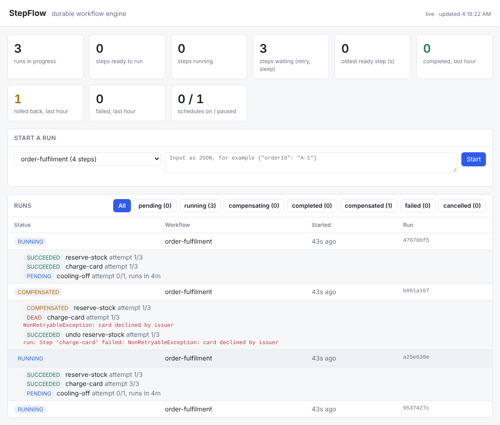

# StepFlow

[](https://github.com/raigaurav26/stepflow/actions/workflows/ci.yml)

A durable workflow engine built on Spring Boot and PostgreSQL.

You describe a business process (for example *reserve stock → charge card → ship order*) as a list of steps. StepFlow stores every run and every step in PostgreSQL, so a process survives crashes and restarts. Failed steps are retried with backoff, and if a step finally gives up, the steps that already succeeded are undone in reverse order (the saga pattern).

The idea is similar to Temporal or AWS Step Functions, written from scratch to show how they work underneath: database-backed queues, leases, retries, idempotency and compensation.

## Tech stack

Java 17 · Spring Boot 3 · PostgreSQL 16 · Flyway · JdbcTemplate · JUnit 5 · GitHub Actions

## How it works (design)

| Concept | Table | Notes |
|---|---|---|
| Workflow run | `workflow_runs` | One execution of a workflow, with input, output and an optional idempotency key |
| Step execution | `step_executions` | One row per step (`ACTION`) or per undo (`COMPENSATION`); workers claim runnable rows like a queue |

Run lifecycle:

```
PENDING → RUNNING → COMPLETED
                  → COMPENSATING → COMPENSATED
                  → FAILED
PENDING / RUNNING → CANCELLED
```

Step lifecycle:

```
PENDING → LEASED → SUCCEEDED → COMPENSATED
             ↓  ↑
       RETRY_SCHEDULED
             ↓
           DEAD
LEASED → PENDING   (lease expired: the worker crashed)
```

Status transitions are enforced in code (`RunStatus`, `StepStatus`) and status values by `CHECK` constraints in the schema.

## Dashboard

Open `http://localhost:8080/` for a live view of the system (it refreshes every 2 seconds, no build step, no external scripts):



- Cards: runs in progress, steps ready, running and waiting, how long the oldest ready step has waited, and runs completed, rolled back and failed in the last hour.
- Click a run to see its steps: status, attempt count, when a waiting step will run next, which worker holds a running step, and the last error. Rollbacks show as `undo <step>` rows.
- Filter runs by status, or start a run from the form.

The page reads `GET /api/overview` and `GET /api/runs?status=`, both usable on their own.

## Defining a workflow

Register a `WorkflowDefinition` bean. Each step returns a map that is saved as JSON and passed to later steps.

```java
@Bean
WorkflowDefinition orderFulfilment(InventoryClient inventory, PaymentClient payments) {
    return WorkflowDefinition.builder("order-fulfilment")
            .step("reserve-stock", ctx -> inventory.reserve(ctx.input()))
            .step("charge-card", 5, ctx -> payments.charge(ctx.outputOf("reserve-stock")))
            .step("ship", ctx -> Map.of("trackingId", "TRK-1"))
            .build();
}
```

The number after the step name is how many attempts it gets (default 3). Steps should be safe to run twice, because a retry or a crashed worker can repeat one.

## Saga rollback

Some steps can't be wrapped in one database transaction because they call other systems: a flight is booked, a hotel is booked, then the card is declined. A saga undoes the steps that already happened instead. Give a step a compensation:

```java
WorkflowDefinition.builder("trip-booking")
        .step("book-flight", ctx -> airline.book(ctx.input()))
        .compensateWith(ctx -> airline.cancel(ctx.outputOf("book-flight")))
        .step("book-hotel", ctx -> hotels.book(ctx.input()))
        .compensateWith(ctx -> hotels.cancel(ctx.outputOf("book-hotel")))
        .step("send-itinerary", ctx -> email.send(ctx.input()))   // nothing to undo
        .step("charge-card", ctx -> payments.charge(ctx.input()))
        .build();
```

If `charge-card` fails for good, the run moves to `COMPENSATING` and the hotel is cancelled, then the flight: newest first, skipping steps with nothing to undo. Then the run is `COMPENSATED` and keeps the original error.

- Compensations are rows in the same queue (`kind = 'COMPENSATION'`), so they get the same leasing, retries, backoff and crash safety as normal steps.
- Each compensation is queued in the same transaction that records the previous one, so a crash mid-rollback picks up where it stopped.
- If a compensation runs out of attempts, the rollback stops and the run is `FAILED` with both errors. Undoing further could make things worse, so the remaining steps are left for a person to check.

## Timers and schedules

**Sleep steps.** `.sleep("cooling-off-period", Duration.ofHours(48))` makes the run wait before the next step. No thread sleeps: the step is queued with `next_run_at` in the future and simply isn't claimable until then, so a two-day wait survives deploys and restarts.

**Delayed start.** `POST /api/runs` takes an optional `startAt` (ISO-8601). The run exists as `PENDING` straight away, and its first step becomes claimable at that time. A time in the past means now.

**Cron schedules.** Start a workflow on a schedule, in a time zone:

```bash
curl -X POST localhost:8080/api/schedules -H 'Content-Type: application/json' -d '{
  "name": "weekday-report", "workflowType": "daily-report",
  "cron": "0 0 9 * * MON-FRI", "zone": "Asia/Kolkata", "input": {"format": "pdf"}
}'
```

- Every instance runs the scheduler. Due schedules are locked with `FOR UPDATE SKIP LOCKED`, so each slot fires once however many instances there are (a test runs 6 at once).
- Each fired run gets the idempotency key `schedule:<id>:<slot>`, so a slot can never start two runs.
- After downtime, a schedule fires once for the slot it missed, then jumps ahead. It doesn't replay every missed slot.
- Paused schedules skip the slots they missed when resumed. A schedule whose workflow no longer exists is disabled instead of failing every tick.

| Method | Path | |
|---|---|---|
| POST | `/api/schedules` | Create (`409` if the name is taken, `400` bad cron or zone) |
| GET | `/api/schedules`, `/api/schedules/{id}` | List or read |
| POST | `/api/schedules/{id}/pause`, `/resume` | Pause or resume |
| DELETE | `/api/schedules/{id}` | Delete |

## API

| Method | Path | What it does |
|---|---|---|
| GET | `/api/workflows` | Registered workflows and their steps |
| POST | `/api/runs` | Start a run: `{"workflowType": "order-fulfilment", "input": {...}}` → `201` with `Location` |
| GET | `/api/runs/{id}` | A run with all of its steps |
| GET | `/api/runs?limit=20&status=FAILED` | Most recent runs, optionally one status |
| GET | `/api/overview` | Run counts by status, queue state, last-hour results |

### Idempotent starts

A client that times out on `POST /api/runs` can't tell whether the run started. Sending the request again could pay someone twice. With an `Idempotency-Key` header, it's safe to resend:

```bash
curl -X POST localhost:8080/api/runs \
  -H 'Content-Type: application/json' -H 'Idempotency-Key: payout-77' \
  -d '{"workflowType": "payout", "input": {"amount": 1500}}'
```

| Request | Response |
|---|---|
| First request with a key | `201 Created`, new run |
| Same key, same workflow and input | `200 OK`, the original run, `Idempotent-Replayed: true` |
| Same key, different workflow or input | `409 Conflict` with `existingRunId` |
| No key | `201 Created`, always a new run |

The insert uses `ON CONFLICT (idempotency_key) DO NOTHING` on a unique column rather than check-then-insert, so requests racing with the same key can't both create a run. A test sends 12 at once and gets exactly one run and one queued step.

Starting a run creates it as `PENDING` and queues only its first step. Each later step is queued when the one before it succeeds, so the step table only ever holds work that can run now. Errors use RFC 7807 problem details (`404` unknown run, `422` unknown workflow type, `409` idempotency key reused, `400` invalid body).

## Workers

Each instance runs a small worker pool (`WorkerPool`). A poller thread claims runnable steps and hands them to a fixed number of threads:

```sql
UPDATE step_executions SET status = 'LEASED', lease_owner = ?, lease_expires_at = now() + ?, attempt = attempt + 1
 WHERE id IN (SELECT id FROM step_executions
               WHERE status IN ('PENDING', 'RETRY_SCHEDULED') AND next_run_at <= now()
               ORDER BY next_run_at LIMIT ?
                 FOR UPDATE SKIP LOCKED)
RETURNING *;
```

- `SKIP LOCKED` lets many workers, across many instances, poll the same table without blocking each other or taking the same step twice. A test runs 8 workers against 300 steps and checks each is claimed exactly once.
- The poller only claims as many steps as it has free threads, so a busy instance leaves work for the others.
- Every result is written with `WHERE lease_owner = ?`. A worker that lost its lease can't overwrite the new owner's result.
- When a step succeeds, the next step is queued in the same transaction. After the last step, the run is `COMPLETED` with that step's output.
- A failing step is retried until it runs out of attempts. Then it is `DEAD` and the run is `FAILED` with the error.

## Crash recovery

A claimed step is leased, not owned. If the worker holding it dies (crash, `kill -9`, lost database connection), the lease runs out and the step goes back in the queue:

- **Heartbeats.** While a step runs, its worker renews the lease every third of `lease-duration`. A slow step keeps its lease. Only a worker that has stopped renewing loses one. A test runs a 2.5s step with a 0.9s lease while reclaiming constantly, and the step runs exactly once.
- **Reaper.** Every instance checks for expired leases every `reap-interval` (`FOR UPDATE SKIP LOCKED`, so instances don't collide) and puts those steps back as `PENDING`, noting which worker lost them.
- **Fencing.** If the "dead" worker was only paused and comes back, its result is ignored, because every write checks `lease_owner`.
- **No poison loops.** The lost attempt still counts. A step that crashes its worker on every attempt runs out of attempts and fails (and rolls back) like any other failure, instead of crashing workers forever.

Because a step can run again after a crash, step handlers should be idempotent: use the run id as an idempotency key when calling other systems.

## Chaos tests

`ChaosIntegrationTest` runs the real worker pool, lease heartbeats and reaper with a 600ms lease, and makes workers die in the middle of steps. A crash is an `Error` thrown from the handler: the executor only catches `Exception`, so nothing is written back and the lease is left to expire, as with a killed process.

- **Random deaths:** 40 three-step runs where about 30% of early attempts crash. All 40 runs complete, every step has exactly one recorded result, no lease is left behind, and every step's work happened at least once.
- **Everyone dies for a while:** all workers crash for 2 seconds. Nothing finishes meanwhile; once the storm ends, all 20 runs complete.

Delivery is at-least-once: a crash after the work but before the result is saved repeats the work. The tests check that repeats never exceed the number of crashes. Handlers should be idempotent (use the run id as the idempotency key when calling other systems).

## Metrics

`GET /actuator/prometheus` exposes Prometheus metrics (Micrometer). Tags are the workflow type and step name only, never ids, so the number of series stays small.

| Metric | Type | What it tells you |
|---|---|---|
| `stepflow_step_duration_seconds{workflow,step,kind,outcome}` | timer + histogram | Handler runtime, and how many attempts succeeded or failed |
| `stepflow_step_retries_total{workflow,step}` | counter | Failed attempts that were scheduled to retry |
| `stepflow_step_dead_total{workflow,step,kind}` | counter | Steps that ran out of attempts |
| `stepflow_runs_started_total{workflow}` | counter | Runs started |
| `stepflow_runs_finished_total{workflow,status}` | counter | Runs that ended `COMPLETED`, `COMPENSATED` or `FAILED` |
| `stepflow_leases_reclaimed_total` | counter | Steps taken back from crashed workers |
| `stepflow_lease_lost_total{workflow,step}` | counter | Results dropped because the lease had been taken over |
| `stepflow_queue_steps{state}` | gauge | Steps `runnable` (ready now), `waiting` (backoff, sleeps, delayed starts) or `leased` |
| `stepflow_queue_oldest_runnable_seconds` | gauge | How long the longest-waiting runnable step has waited |
| `stepflow_runs_active{status}` | gauge | Runs still `PENDING`, `RUNNING` or `COMPENSATING` |

The queue gauges are read from the database (one cached query per second), so every instance reports the same system-wide numbers.

Useful queries:

```promql
# add workers when steps are waiting for a free one
stepflow_queue_oldest_runnable_seconds > 30

# failing runs per minute, by workflow
sum by (workflow) (rate(stepflow_runs_finished_total{status="FAILED"}[5m])) * 60

# p95 step latency
histogram_quantile(0.95, sum by (le, workflow, step) (rate(stepflow_step_duration_seconds_bucket[5m])))

# workers are crashing
rate(stepflow_leases_reclaimed_total[10m]) > 0
```

## Retries

A failed step goes to `RETRY_SCHEDULED` with `next_run_at` set in the future, so the wait survives restarts and no thread sleeps through it. The wait grows exponentially, is capped, and has jitter so that many steps failing together (a partner API going down) don't all retry in the same instant:

```
wait(n) = min(initialDelay * multiplier^(n-1), maxDelay) * (1 - jitter * random)
```

With the defaults (1s, ×2, 5m cap, 20% jitter) the waits are about 1s, 2s, 4s, 8s … up to 5 minutes. A step can set its own policy:

```java
.step("charge-card", 5, RetryPolicy.exponential(Duration.ofSeconds(2), Duration.ofMinutes(1)), ctx -> ...)
```

Throw `NonRetryableException` when trying again can't help (a declined card, invalid input). The step goes straight to `DEAD` without using up its attempts.

| Setting | Default | |
|---|---|---|
| `stepflow.worker.enabled` | `true` | Turn the pool off for API-only instances |
| `stepflow.worker.threads` | `4` | Steps run at the same time per instance |
| `stepflow.worker.poll-interval` | `500ms` | Wait between polls when the queue is empty |
| `stepflow.worker.lease-duration` | `30s` | How long a claimed step belongs to one worker without a heartbeat |
| `stepflow.worker.reap-interval` | `10s` | How often to reclaim steps from crashed workers |
| `stepflow.scheduler.enabled` | `true` | Fire due cron schedules from this instance |
| `stepflow.scheduler.poll-interval` | `1s` | How often to check for due schedules |
| `stepflow.retry.initial-delay` | `1s` | Wait before the first retry |
| `stepflow.retry.multiplier` | `2.0` | Growth of the wait after each failure |
| `stepflow.retry.max-delay` | `5m` | Longest wait between attempts |
| `stepflow.retry.jitter` | `0.2` | Up to this share of the wait is randomly removed |

## Running locally

```bash
docker compose up -d      # PostgreSQL on localhost:5432
mvn spring-boot:run       # Flyway creates the schema on startup
curl localhost:8080/actuator/health
```

Tests need the same PostgreSQL (`docker compose up -d`, then `mvn verify`). CI starts it as a service container.

Connection settings can be overridden with `STEPFLOW_DB_URL`, `STEPFLOW_DB_USER` and `STEPFLOW_DB_PASSWORD`.

## Demo: order fulfilment

With `STEPFLOW_DEMO_ENABLED=true` the app registers an `order-fulfilment` workflow: reserve stock, charge card (retried with backoff), an optional cooling-off timer, then ship. Each step has a compensation, so a declined card releases the stock and a shipping failure refunds the card and then releases the stock.

```bash
docker compose up --build      # Postgres + app with the demo enabled, port 8080
./scripts/demo.sh              # posts a mix of good, flaky, declined and failing orders
```

Open http://localhost:8080/ to watch the runs on the dashboard.

## Roadmap

- [x] Project setup, schema and status state machines
- [x] Workflow definition API and `POST /api/runs` to start a run
- [x] Worker pool that claims steps with `SELECT ... FOR UPDATE SKIP LOCKED`
- [x] Retries with exponential backoff and jitter, dead steps
- [x] Saga compensation in reverse order
- [x] Idempotent run start (`Idempotency-Key` header)
- [x] Durable timers (`sleep` steps), delayed starts and cron schedules
- [x] Lease expiry recovery when a worker crashes mid-step, with lease heartbeats
- [x] Chaos tests: kill workers mid-run and check nothing is lost or stuck
- [x] Metrics with Micrometer and Prometheus
- [x] Web dashboard of runs and steps
- [x] Demo workflow: order fulfilment, Dockerfile and Docker Compose
